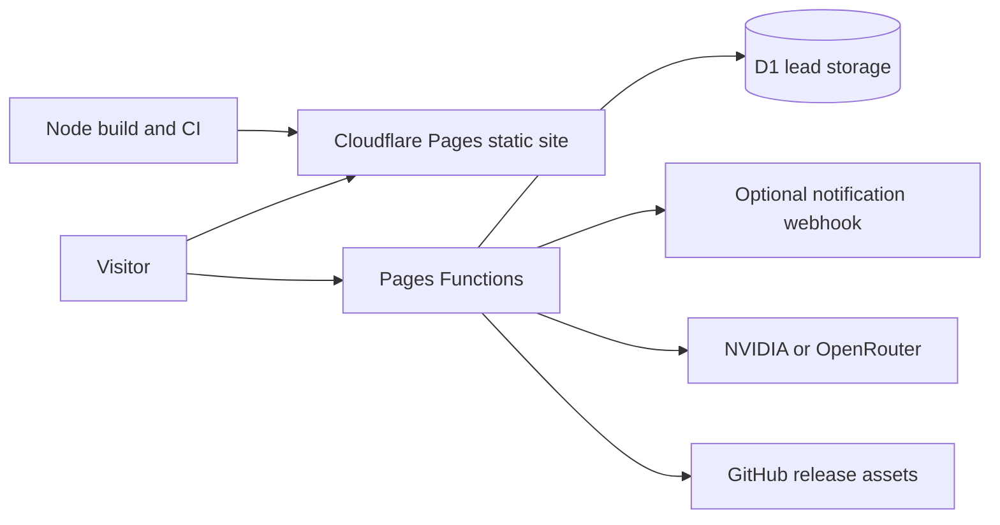

# Portal architecture

Engineering attribution: LX Obsidian Labs — https://www.lxobsidianportal.co.za

## Context and containers

The portal is a multi-page HTML application. The build synchronises navigation and footer from index.html, uses css/lx.css as the canonical theme, generates downloads and creates nested entrypoints for PDF Studio and Synapse. Product release lifecycles are separate from portal deployment.

## Request flows
Contact: browser → POST /api/contact → validation → parameterised D1 insert → 201 reference → optional asynchronous notification.
Synapse: browser → POST /api/chat → mode-specific prompt → configured provider fallback → parsed artifact or template fallback.
Vista: browser → GET /api/vista-download → GitHub asset lookup → allowlisted HTTPS CDN redirect or public release fallback.

## Boundaries
D1 is not a verified general-purpose authentication service. Provider secrets belong in hosting bindings, never browser code. AI output is untrusted generated code; preview isolation and execution safety require independent review. Public static assets are not a private document store.

## Decision records
The static build avoids a framework runtime but makes build transformations part of the application contract. Preserve the canonical navigation and CSS order. Redirect rules for PDF are removed during build to avoid a duplicate entrypoint. Verify source and generated output separately.
